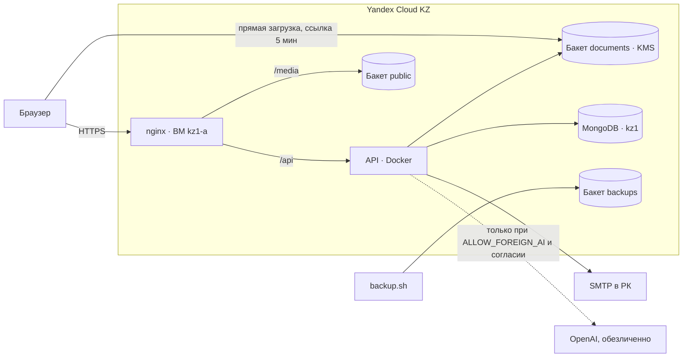

# Переезд UmaiSense в Yandex Cloud, регион Казахстан (kz1)

Цель: сайт, API, база, документы, фото, бэкапы и логи работают **только в Yandex Cloud KZ**.
Vercel, Netlify, MongoDB Atlas и Cloudinary больше не используются. Единственное исключение, которое
вы выбрали сознательно, — ИИ через OpenAI: он включается флагом `ALLOW_FOREIGN_AI=true`, получает
только **обезличенные** данные и только у родителей, давших согласие на трансграничную передачу.

> Я не юрист. Политику (`/privacy`), согласия и договор с Yandex Cloud должен проверить юрист РК
> (вопросы — в разделе 10).

---

## 0. Быстрый старт через консоль (без Terraform и WSL)

Самый короткий путь: всё создаётся мышкой в https://kz.console.yandex.cloud, команды — в PowerShell
и на сервере по SSH. Сайт сначала открывается по IP-адресу (только HTTP, для проверки);
HTTPS включается, когда появится домен (раздел 0.7).

### 0.1. SSH-ключ (PowerShell на своём компьютере)
```
ssh-keygen -t ed25519 -C umaisense
type $env:USERPROFILE\.ssh\id_ed25519.pub
```
Строку `ssh-ed25519 AAAA… umaisense` понадобится вставить при создании сервера.

### 0.2. Сервер (Compute Cloud → Создать ВМ)
- Образ: **Ubuntu 24.04 LTS**; зона **kz1-a**.
- Диск: SSD, 40 ГБ. Вычислительные ресурсы: 2 vCPU (100 %), 4 ГБ RAM.
- Сеть: `default`, публичный адрес — «Автоматически».
- Доступ: логин **umaisense**, SSH-ключ — строка из 0.1.
- После создания: Virtual Private Cloud → IP-адреса → у адреса сервера «Сделать статическим»
  (иначе IP сменится после перезагрузки).

### 0.3. Группа безопасности
Virtual Private Cloud → Группы безопасности → `default-sg-…` → добавить входящие правила TCP:
22 (лучше только с вашего IP `x.x.x.x/32`), 80 и 443 — источник `0.0.0.0/0`.
Правило «Self» (трафик внутри группы) должно остаться — через него сервер ходит в базу.

### 0.4. База (Managed Service for MongoDB / StoreDoc → Создать кластер)
- Окружение PRODUCTION, последняя доступная версия, самый маленький класс хоста, SSD 10–20 ГБ.
- Сеть `default`, зона kz1-a, группа безопасности `default-sg-…`, **публичный доступ выключен**.
- База **umai_sense**, пользователь **umaisense**, пароль — только буквы и цифры, от 12 символов.
- Защита от удаления — включить. Создание занимает 10–15 минут.
- Хост для подключения: вкладка «Хосты» (имя вида `….mdb.yandexcloud.kz`).

### 0.5. Хранилище (Object Storage)
1. Сервисный аккаунт: Identity and Access Management → Сервисные аккаунты → `umaisense-app`,
   роль `storage.editor` → «Создать новый ключ» → «Статический ключ доступа».
   Сохраните идентификатор и секрет — секрет показывается один раз.
2. Бакет документов `umaisense-docs-<что-то уникальное>`: доступ на чтение объектов и к списку —
   **закрытый**. В настройках бакета → CORS: источник `http://<IP>`, методы GET, PUT, HEAD, заголовки `*`.
3. Бакет фото `umaisense-public-<что-то уникальное>`: чтение объектов — **публичное**, список — закрытый.

### 0.6. Установка на сервер (PowerShell → SSH)
```
ssh umaisense@<IP>
sudo mkdir -p /opt/umaisense && sudo chown umaisense: /opt/umaisense
git clone -b feature/ai-screening-privacy https://github.com/JackSparrow322432/UmaI-Sense.site.git /opt/umaisense/src
sudo /opt/umaisense/src/infra/yandex-kz/scripts/server-setup.sh
exit
```
Если репозиторий закрытый, git спросит логин и пароль: вместо пароля — токен GitHub
(Settings → Developer settings → Personal access tokens → Fine-grained, доступ Contents: Read-only
к одному репозиторию).
Чтобы `deploy.sh` не спрашивал токен каждый раз: `git -C /opt/umaisense/src config credential.helper store`
(токен сохранится на сервере — поэтому только read-only и только на этот репозиторий).

Снова зайдите и заполните настройки:
```
ssh umaisense@<IP>
cp /opt/umaisense/src/infra/yandex-kz/app/env.quickstart.example /opt/umaisense/.env
nano /opt/umaisense/.env          # заполнить <…>; сохранить Ctrl+O, Enter, выйти Ctrl+X
openssl rand -base64 48           # если нужен новый JWT_SECRET
/opt/umaisense/src/infra/yandex-kz/scripts/deploy.sh
```
Первая сборка — 5–10 минут. В конце: `OK: http://<IP> работает`. Откройте `http://<IP>` в браузере.

Пустая база: войдите администратором (`ADMIN_EMAIL` / `ADMIN_PASSWORD`). Перенос данных из Atlas
и файлов из Cloudinary — раздел 5 (шаги 2–3).

### 0.7. Когда появится домен
A-запись домена → IP сервера. В `.env`: `DOMAIN=<домен>`, `CLIENT_URL=https://<домен>`,
`S3_PUBLIC_URL=https://<домен>/media`, `LETSENCRYPT_EMAIL=<почта>`; в CORS бакета документов —
`https://<домен>`. Затем `deploy.sh` — он сам выпустит сертификат и включит HTTPS.

---

## 1. Что было и что станет

| Компонент | Было | Стало (Yandex Cloud KZ) |
|---|---|---|
| Фронтенд | Netlify / Vercel | nginx на ВМ `umaisense-web` (kz1-a) |
| API | Vercel Functions (США) | Docker-контейнер на той же ВМ |
| База | MongoDB Atlas | Managed Service for MongoDB (kz1) **или** MongoDB в контейнере на ВМ |
| Документы | Cloudinary | закрытый бакет `…-documents` (Object Storage KZ, шифрование KMS) |
| Фото, обложки | Cloudinary | публичный бакет `…-public`, отдаётся через `https://<домен>/media/` |
| Бэкапы | — | Managed-бэкапы кластера + зашифрованные (age) дампы в бакет `…-backups` |
| Почта | Gmail SMTP | SMTP-провайдер в РК (указывается в `LOCALITY_ALLOWED_HOSTS`) |
| ИИ | OpenAI | `off` по умолчанию; OpenAI — только с `ALLOW_FOREIGN_AI=true` |
| Состояние Terraform | — | бакет в Object Storage KZ |

**Что есть в регионе KZ** (по списку эндпоинтов Yandex Cloud KZ): Compute, VPC, Object Storage,
Managed MongoDB, KMS, Lockbox, Certificate Manager, Container Registry, ALB, DNS, Logging.
**Чего нет:** YandexGPT / AI Studio и Postbox (почта). Поэтому ИИ — OpenAI по флагу (или своя модель
`AI_SCREENING_PROVIDER=local` позже), а почта — через SMTP-провайдера в Казахстане.

Сервер **не запустится** в production, если в настройках найдётся адрес за пределами KZ
(Atlas, Cloudinary, Gmail, S3 не в `yandexcloud.kz`, OpenAI без флага) — проверка в
`umaisense-back-main/src/utils/env.ts`.



---

## 2. Варианты и стоимость

| | Вариант А (рекомендуется) | Вариант Б (дешевле) |
|---|---|---|
| База | Managed MongoDB, `s3-c2-m8`, 20 ГБ SSD | MongoDB в контейнере на ВМ |
| ВМ | 2 vCPU / 4 ГБ / 40 ГБ SSD | 2 vCPU / 4 ГБ / 40 ГБ SSD |
| Бэкапы базы | встроенные (7 дней) + `backup.sh` | только `backup.sh` |
| Обновления MongoDB | делает Yandex | вручную |
| Переключатель | `use_managed_mongodb = true` | `use_managed_mongodb = false` |

**Цены не привожу** — посчитайте оба варианта в калькуляторе консоли Yandex Cloud для региона
Казахстан (тенге, с НДС) **до** `tofu apply`. Плата начинается сразу после создания ресурсов.

---

## 3. Что лежит в репозитории

```
infra/yandex-kz/
  *.tf                    сеть, группы безопасности, ВМ, MongoDB, бакеты, KMS, сервисные аккаунты, DNS
  cloud-init.yaml         первичная настройка ВМ (Docker, firewall, fail2ban, без входа по паролю)
  terraform.tfvars.example, backend.hcl.example
  app/docker-compose.yml  nginx + api + certbot (+ mongo для варианта Б)
  app/nginx/              HTTPS, HSTS, CSP, SPA, /api, /media
  scripts/
    bootstrap-state.sh    профиль yc для KZ, сервисный аккаунт Terraform, бакет состояния
    deploy.sh             сборка и выкладка на сервере (из git), выпуск сертификата
    migrate-from-atlas.sh перенос базы из Atlas со сверкой количества документов
    migrate-files.sh      перенос файлов из Cloudinary в бакеты KZ
    backup.sh             зашифрованный бэкап базы в бакет backups
    verify-locality.sh    проверка: настройки, DNS, исходящие соединения, код
.github/workflows/
  ci.yml                  проверка типов и сборка
  deploy-yandex-kz.yml    выкладка по кнопке (в GitHub нет секретов приложения)
```

---

## 4. Пошагово

Команды выполняются в Linux/macOS или в **WSL на Windows** (`wsl --install` в PowerShell от администратора).
Нужны: [yc CLI](https://yandex.cloud/ru/docs/cli/quickstart), OpenTofu или Terraform, `jq`, `ssh`.

### 4.1. Подготовка аккаунта (один раз)
1. В консоли Yandex Cloud KZ (https://kz.console.yandex.cloud) используйте каталог `default` или создайте `umaisense`,
   привяжите платёжный аккаунт. Запишите `cloud_id` и `folder_id`.
2. Ключ SSH (если нет): `ssh-keygen -t ed25519 -C umaisense`.
3. Состояние Terraform и сервисный аккаунт:
   ```bash
   CLOUD_ID=<id облака> FOLDER_ID=<id каталога, например ao7...> ./infra/yandex-kz/scripts/bootstrap-state.sh
   ```
   Ключи окажутся в `~/.umaisense-kz/` (права 700). **Не коммитьте их и не загружайте в GitHub.**

### 4.2. Инфраструктура
```bash
cd infra/yandex-kz
cp terraform.tfvars.example terraform.tfvars   # cloud_id, folder_id, ssh_public_key, admin_ip_cidrs, mongo_password …
tofu init -backend-config=$HOME/.umaisense-kz/backend.hcl
tofu plan -out plan.bin          # ← проверьте список ресурсов и посчитайте стоимость
tofu apply plan.bin              # ← здесь начинаются платежи
tofu output web_ip
tofu output -raw app_env    > ~/.umaisense-kz/app.env
tofu output -raw backup_env > ~/.umaisense-kz/backup.env
```
`admin_ip_cidrs` — ваш домашний/офисный IP с `/32`: SSH открыт только для него.

### 4.3. Сервер
```bash
ssh umaisense@<web_ip>
git clone https://github.com/JackSparrow322432/UmaI-Sense.site.git /opt/umaisense/src
nano /opt/umaisense/.env      # см. ниже
chmod 600 /opt/umaisense/.env
```
Содержимое `.env` = `app.env` + `backup.env` + значения ниже (шаблон — `umaisense-back-main/.env.example`):
```
NODE_ENV=production
LETSENCRYPT_EMAIL=you@example.kz
JWT_SECRET=<тот же, что сейчас на Vercel — иначе всех разлогинит>
SMTP_HOST=<SMTP провайдера в РК>   SMTP_PORT=465   SMTP_USER=<адрес отправителя>   SMTP_PASS=...
LOCALITY_ALLOWED_HOSTS=<SMTP_HOST>
AI_SCREENING_PROVIDER=openai
ALLOW_FOREIGN_AI=true
OPENAI_API_KEY=<новый ключ>
CONSENT_VERSION=2026-10-09
```
Если репозиторий закрытый — добавьте на сервере deploy key только для чтения
(`ssh-keygen -t ed25519 -f ~/.ssh/github_ro`, публичную часть — в GitHub → Settings → Deploy keys).

### 4.4. Проверка без переключения DNS
```bash
/opt/umaisense/src/infra/yandex-kz/scripts/verify-locality.sh --env-only
```
Должно быть «нарушений не найдено». До смены DNS сертификат не выпустится — это нормально, сначала перенос данных.

---

## 5. Окно переезда (≈1 час, лучше ночью)

1. Объявите пользователям техработы. На Vercel включите режим обслуживания или временно удалите
   `MONGO_URI` из переменных (API перестанет писать в Atlas).
2. **База:**
   ```bash
   ATLAS_URI='mongodb+srv://…mongodb.net/umai_sense' /opt/umaisense/src/infra/yandex-kz/scripts/migrate-from-atlas.sh
   ```
   Скрипт сверит количество документов по каждой коллекции.
3. **Файлы:**
   ```bash
   export CLOUDINARY_CLOUD_NAME=… CLOUDINARY_API_KEY=… CLOUDINARY_API_SECRET=…
   /opt/umaisense/src/infra/yandex-kz/scripts/migrate-files.sh --dry-run
   /opt/umaisense/src/infra/yandex-kz/scripts/migrate-files.sh
   unset CLOUDINARY_CLOUD_NAME CLOUDINARY_API_KEY CLOUDINARY_API_SECRET
   ```
4. **DNS** *(делаете вы, вручную)*: A-запись `app.umaisense.kz` → `web_ip`, TTL 300.
   Подождите, пока `nslookup app.umaisense.kz` начнёт возвращать новый IP.
5. **Выкладка:** `/opt/umaisense/src/infra/yandex-kz/scripts/deploy.sh main`
   (сам выпустит сертификат Let's Encrypt).
6. **Проверка:** вход, карточка ребёнка, загрузка и скачивание документа, PDF-отчёт, ИИ-скрининг,
   письмо с кодом. Затем полная проверка локальности:
   ```bash
   CAPTURE_SECONDS=600 /opt/umaisense/src/infra/yandex-kz/scripts/verify-locality.sh
   ```
7. **Бэкапы:** настройте `backup.sh` по инструкции в начале файла и проверьте восстановление
   из бэкапа на тестовую базу.

### Откат
Пока Atlas, Cloudinary и Vercel не удалены, откат = вернуть A-запись на старый адрес и вернуть
`MONGO_URI` на Vercel. Данные, внесённые после переезда, придётся перенести обратно вручную
(тот же `mongodump`/`mongorestore` в обратную сторону), поэтому решайте об откате в первые часы.
Откат версии приложения на сервере: `deploy.sh <предыдущий-коммит>`.

---

## 6. После переезда (через 1–2 недели стабильной работы, вручную)

- [ ] Удалить кластер MongoDB Atlas (предварительно сделать финальный дамп и сохранить офлайн, зашифрованным).
- [ ] Удалить файлы и аккаунт Cloudinary.
- [ ] Удалить проекты Vercel и Netlify, переменные окружения в них (там старые секреты).
- [ ] Выпустить новый `JWT_SECRET` (все пользователи войдут заново), новый ключ OpenAI, новые ключи SMTP.
- [ ] Отозвать старые ключи Atlas/Cloudinary/Gmail.
- [ ] Включить в GitHub защиту ветки `main` и (по желанию) выкладку по кнопке — `deploy-yandex-kz.yml`.

Ни один из этих шагов скрипты не выполняют сами.

---

## 7. Выкладка обновлений

- Вручную: `ssh umaisense@<web_ip> /opt/umaisense/src/infra/yandex-kz/scripts/deploy.sh main`.
- Из GitHub: Actions → *Deploy (Yandex Cloud KZ)* → Run workflow. Настройка — в комментарии в начале
  `.github/workflows/deploy-yandex-kz.yml`: отдельный SSH-ключ, которому разрешена только команда
  `deploy.sh`. Секретов приложения в GitHub нет.

---

## 8. Безопасность

- SSH — только по ключу и только с `admin_ip_cidrs`; fail2ban; автоматические обновления безопасности.
- Наружу открыты только 80/443. MongoDB доступна только с ВМ (группа безопасности), по TLS.
- Документы — в закрытом бакете с шифрованием KMS и версионированием; ссылки на скачивание — 5 минут.
- Диск ВМ зашифрован ключом KMS. Ключ KMS защищён от удаления (`prevent_destroy`).
- Секреты — только в `/opt/umaisense/.env` (600) и в `~/.umaisense-kz/` у владельца.
  Позже их можно перенести в Lockbox.
- Заголовки HSTS, CSP (браузер ходит только на ваш домен и `storage.yandexcloud.kz`), X-Frame-Options.

---

## 9. Ручной чек-лист

- [ ] Калькулятор: стоимость варианта А/Б посчитана и согласована.
- [ ] `tofu plan` просмотрен, ресурсов только в `kz1`.
- [ ] `.env` на сервере заполнен, `verify-locality.sh --env-only` — без FAIL.
- [ ] База перенесена, количество документов совпадает.
- [ ] Файлы перенесены, в базе нет ссылок `res.cloudinary.com` (`migrate-files.sh --dry-run` показывает 0).
- [ ] DNS переключён, сертификат выпущен, сайт открывается по HTTPS.
- [ ] Вход, документы, PDF, ИИ, письма проверены.
- [ ] Полный `verify-locality.sh` — исходящие соединения только в Yandex Cloud KZ, SMTP РК и (по флагу) OpenAI.
- [ ] Бэкап создан и восстановление проверено.
- [ ] В `legalInfo.ts` заполнены реквизиты оператора, хостинга (юрлицо Yandex Cloud по договору) и почтового сервиса.

---

## 10. Юридические вопросы (к юристу РК)

1. **Аккаунт на физлицо.** Аккаунт Yandex Cloud зарегистрирован на вас как физическое лицо, а оператором
   персональных данных в политике указано ТОО «UmaiSense». Нужно, чтобы договор с облаком был заключён
   с тем же лицом, что и оператор, — или перевести аккаунт на ТОО (в консоли: смена платёжного аккаунта
   на юрлицо), или изменить оператора в политике.
2. **Договор с Yandex Cloud.** Проверить условия обработки данных (поручение обработки по ст. 8 Закона
   № 94-V) и указать юрлицо провайдера в `legalInfo.ts → PROVIDERS.hosting`.
3. **Трансграничная передача в OpenAI** (ст. 16): данные обезличиваются, но для медицинского контекста
   юрист должен подтвердить, что согласия `cross_border` достаточно. Без флага `ALLOW_FOREIGN_AI` ИИ выключен.
4. **SMTP-провайдер** — указать в политике в разделе «Передача третьим лицам».
5. **Тексты согласий** — после правок поднять `CONSENT_VERSION` и `LEGAL_VERSION`: пользователи увидят окно с новой редакцией.
