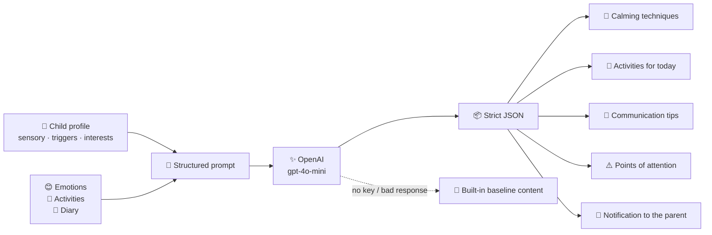
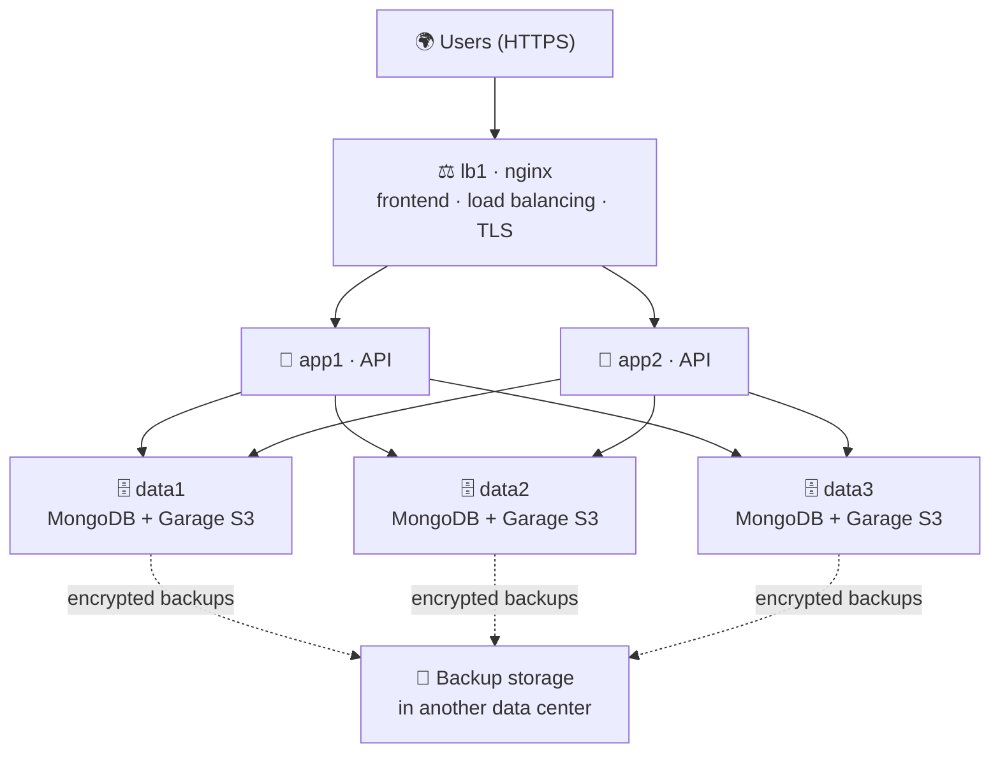

<!-- ======================= HEADER ======================= -->
<p align="center">
  
</p>

<p align="center">
  
</p>

<p align="center">
  
  
  
</p>

<p align="center">
  
  
  
  
  
  
  
  
</p>


## 🌱 What is Umai Sense?

**Umai Sense** is a bilingual (Russian / English) platform that brings together everything a child's support team knows — the child's state, the parent's state and specialists' observations — into **one living profile** and **personalised AI recommendations**.

Most apps hand out a generic list of exercises. Umai Sense helps people **make decisions**: it looks at *this* child's sensory profile, fears, interests and recent days, and at how the family is coping right now — and suggests what to try today.

> 💡 Built on data, neurophysiology and a proprietary methodology developed by the company's co-founder.


## 🧩 The problem we solve

<table>
<tr>
<td width="50%" valign="top">

### 😟 Today
- 📚 Parents drown in contradictory advice
- 🏝 Specialists work in isolation from each other
- 🎲 Decisions about support are made by intuition
- 🔌 No data link between home, school and rehabilitation

</td>
<td width="50%" valign="top">

### ✨ With Umai Sense
- 👤 **One profile** for every child
- 🕒 **One shared timeline** of observations
- 🤖 **Recommendations that update** as the child and family change
- 🤝 Parents, trainers and admins **on the same page**

</td>
</tr>
</table>


## 🎨 Features

| | Feature | What it does |
|:-:|---|---|
| 🧒 | **Child profile** | Diagnosis, communication method, triggers, fears, interests, goals and a full **sensory profile** (sound / light / touch) |
| 😊 | **Emotion tracker** | Daily mood entries for the child |
| 🏃 | **Activities** | Log what the child did and how it went |
| 📔 | **Observation diary** | Free-form notes from parents and trainers on one timeline |
| 🏆 | **Milestones** | A bank of developmental milestones — cognitive, motor, social, speech, self-care — with per-child progress |
| 🤖 | **AI recommendations** | Calming techniques, activities for today, communication tips and points of attention |
| ⛸ | **Adaptive skating enrollment** | Parents request preferred days → admin assigns a trainer → sessions appear in the calendar |
| 📅 | **Schedule** | Weekly slots turned into real calendar sessions, cancellable one by one |
| 📄 | **Documents** | Secure storage of medical documents with short-lived access links |
| ✅ | **Tasks** | Home tasks from specialists, submissions and ratings |
| 🔔 | **Notifications** | In-app feed + email for new recommendations, assignments and access codes |
| 📰 | **Articles** | Educational content managed from the admin panel |
| 🛡 | **Admin panel** | Users, requests, schedule, tasks and articles in one place |


## 🤖 The AI Recommendation Engine

The heart of the product lives in `recommendations.controller`.



- 🧠 **Personal** — every prompt is built from *this* child's profile and their latest days
- 📦 **Predictable** — the model must answer in strict JSON across four categories
- 🛟 **Never a blank screen** — if the API is unavailable, a built-in fallback set is returned
- 🔒 **Privacy-first** — recommendations are built from de-identified data; medical documents are never sent to the AI


## 👥 Roles

<table>
<tr>
<td align="center" width="33%">
<h3>👩‍👧 Parent</h3>
Creates the child's profile, requests enrollment on preferred days, sees the schedule, logs observations and receives AI recommendations
</td>
<td align="center" width="33%">
<h3>⛸ Trainer</h3>
Gets assigned to a child by the admin, unlocks the child's card with a one-time access code and logs observations from their side
</td>
<td align="center" width="33%">
<h3>🛡 Admin</h3>
Processes requests, assigns trainers, manages the full schedule, users and articles. The account is seeded from environment variables — no self-registration
</td>
</tr>
</table>


## 🔐 Security & Privacy

Children's personal and medical data deserve the highest care.

- 🔑 **JWT + email OTP** authentication, passwords hashed with **bcrypt**
- 🪖 **Helmet**, **rate limiting** and **whitelisted CORS** on the API
- 📝 **Consent records** — every agreement is stored with its version, IP and user agent
- 🕵️ **Audit log** — every access to a child's card or document is recorded
- ⏳ **Short-lived document links** — files are served only after a permission check, via a link that expires in minutes
- 🗑 **Right to be forgotten** — a child's data can be purged completely
- 🇰🇿 **Data localisation** — production is moving to servers in Kazakhstan in line with the personal data law


## 🏗 Architecture

### Application

The backend follows a clean **routes → controllers → models** structure, split by domain:

```
auth · children · emotions · activities · diary · milestones · recommendations
notifications · documents · tasks · enrollment · articles · invites · admin
```

`createApp()` builds the Express app once (with a cached MongoDB connection), so the same code runs as a **serverless function** (`api/index.ts`) or as a **classic server / Docker container** (`src/index.ts`).

### Production in Kazakhstan 🇰🇿

Built to survive the loss of any single server and to ship updates with zero downtime.



- 🔁 **MongoDB replica set** across three data nodes
- 🪣 **Garage** — self-hosted S3-compatible storage with three copies of every file
- 🔒 Ports published only on the private network, encrypted data disks
- 💾 Automated backups with documented restore checks

Full guide: [`DEPLOY_FREEDOM_CLOUD.md`](DEPLOY_FREEDOM_CLOUD.md) and the [`deploy/`](deploy) folder.


## 🛠 Tech Stack

<table>
<tr>
<td valign="top" width="33%">

### 🎨 Frontend
- ⚛️ React 19 + TypeScript
- ⚡ Vite 7
- 💨 Tailwind CSS 4
- 🧭 React Router 7
- 🐻 Zustand
- 📡 Axios
- 🔔 Sonner

</td>
<td valign="top" width="33%">

### ⚙️ Backend
- 🟢 Node.js + TypeScript
- 🚂 Express 5
- 🍃 MongoDB + Mongoose
- 🔑 JWT · OTP · bcrypt
- 📧 Nodemailer
- 🤖 OpenAI API
- 🪣 AWS S3 SDK

</td>
<td valign="top" width="33%">

### ☁️ Infrastructure
- 🐳 Docker / Docker Compose
- ⚖️ nginx
- 🍃 MongoDB replica set
- 🪣 Garage (S3)
- ▲ Vercel (current)
- 🇰🇿 Kazakhstan cloud (target)

</td>
</tr>
</table>


## 📁 Project Structure

```
.
├── 🌐 api/index.ts                 # Serverless entrypoint
├── ⚙️ umaisense-back-main/
│   └── src/
│       ├── controllers/            # Business logic per domain
│       ├── models/                 # Mongoose schemas
│       ├── routes/                 # Express routers
│       ├── middleware/             # Auth guard
│       ├── utils/                  # Storage, email, audit, consent, seeding
│       ├── createApp.ts            # Serverless-safe app factory
│       └── index.ts                # Classic entrypoint (local / Docker)
├── 🎨 umiasense-front-main/
│   └── src/
│       ├── api/                    # Axios client + endpoints
│       ├── components/             # Shared UI
│       ├── pages/                  # Auth, children, admin, schedule, ...
│       ├── store/                  # Zustand stores
│       └── hooks/
├── 🚀 deploy/                      # Docker Compose, nginx, backups, migration
└── vercel.json
```


## 🚀 Quick Start

**1. Backend**

```bash
cd umaisense-back-main
npm install
cp .env.example .env    # fill in the values
npm run dev             # → http://localhost:5000
```

**2. Frontend**

```bash
cd umiasense-front-main
npm install
npm run dev             # → http://localhost:5173
```

<details>
<summary><b>🔧 Environment variables</b></summary>

```env
PORT=5000
NODE_ENV=development
MONGO_URI=mongodb://localhost:27017/umai_sense
JWT_SECRET=your_super_secret_key_here
CLIENT_URL=http://localhost:5173

# SMTP (email OTP) — Gmail, Brevo, SendGrid, Mailgun, etc.
SMTP_HOST=smtp.gmail.com
SMTP_PORT=587
SMTP_USER=your@email.com
SMTP_PASS=your_smtp_password

# Admin account (seeded on server start)
ADMIN_EMAIL=admin@yourdomain.com
ADMIN_PASSWORD=your_admin_password

# AI provider
OPENAI_API_KEY=your_openai_api_key

# Time zone for "past" sessions (optional)
APP_TZ=Asia/Almaty
```

See `umaisense-back-main/.env.example` for the full list, including storage settings.
No `OPENAI_API_KEY`? The recommendation engine falls back to built-in baseline content instead of failing.

</details>


## 📡 API Overview

All routes are prefixed with `/api`.

| Domain | Path |
|---|---|
| 🔑 Auth — OTP registration, login, password reset | `/api/auth` |
| 🧒 Children profiles | `/api/children` |
| 😊 Emotions | `/api/emotions` |
| 🏃 Activities | `/api/activities` |
| 📔 Diary | `/api/diary` |
| 🏆 Milestones | `/api/milestones` |
| 🤖 AI recommendations | `/api/recommendations` |
| 📄 Documents | `/api/documents` |
| ✅ Tasks | `/api/tasks` |
| ⛸ Enrollment, assignments, schedule | `/api/enrollment` |
| 🔔 Notifications | `/api/notifications` |
| 📰 Articles | `/api/articles` |
| 🛡 Admin | `/api/admin` |
| 💚 Health check | `/api/health` |


## 💚 Team

Built under **CF «PioneerConcept»** in Almaty, Kazakhstan.

| | Role |
|---|---|
| **Zhanna Karatay** | Co-founder & CEO · author of the methodology |
| **[Amanali Karatay](https://github.com/JackSparrow322432)** | Co-founder & Lead Developer |

<!-- ======================= FOOTER ======================= -->
<p align="center">
  
</p>
